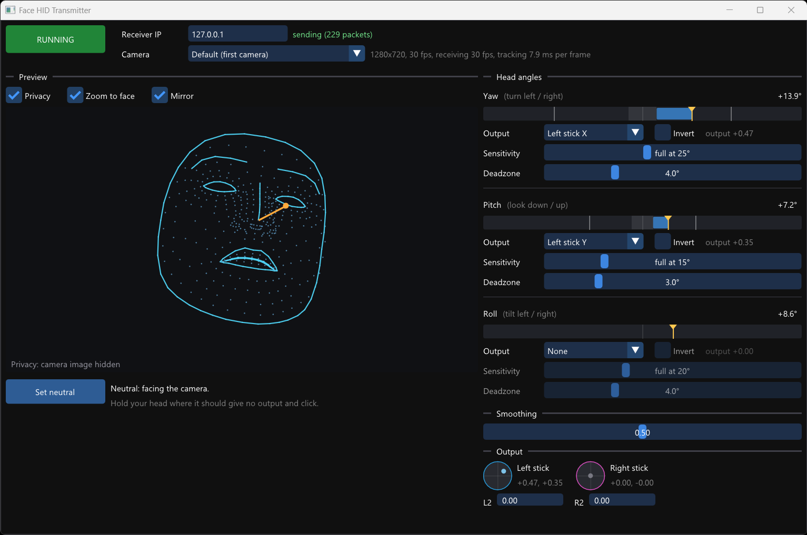

# Face HID Transmitter

This is a Windows application that generates synthetic gamepad inputs based on the position of your face on camera. You can control virtual analog sticks and triggers by turning or tilting your head.

It acts as the Transmitter component of a [HID Forwarder](https://github.com/jfedor2/hid-forwarder) setup. The gamepad inputs generated are sent to the configured Receiver. This way you can control a game on the same PC or on a separate computer or console.

If you want to combine the inputs generated this way with inputs from other sources, like actual game controllers, take a look at the [HID Router](https://github.com/jfedor2/hid-router) project.

For downloads see the [latest release](https://github.com/jfedor2/face-hid-transmitter/releases/latest).

## Usage

- **RUNNING / STOPPED** turns sending on and off.
- **Receiver IP**: the IP of the receiver. Inputs go to UDP port 42734.
- **Camera**: "Default" is the first camera Windows lists, or pick a specific one.
- **Privacy** hides the camera image and shows only the tracked features.
- **Zoom to face** follows the face once it's found, and zooms back out when it's lost.
- **Mirror** flips the image horizontally. It only changes the preview, not the output.
- **Set neutral**: hold your head in the position that should give no output (centered sticks, released triggers) and click.
- Under **Head angles**, each of **yaw** (turning left/right), **pitch** (looking down/up) and **roll** (tilting towards a shoulder) has a bar with the current angle (yellow marker), the deadzone (shaded), the angles that give full output (white lines) and the output (blue).
  - **Output**: sets the axis that this angle drives (joystick X/Y or L2/R2 triggers, either separately or both).
  - **Invert** flips the direction.
  - **Sensitivity**: how far from neutral the head must turn for full output. Lower = more sensitive.
  - **Deadzone**: how far from neutral the head can move with no output. Between the deadzone and the full output angle, the output goes up linearly.
- **Smoothing** steadies the output when holding still, at the cost of a little lag. Fast movements are smoothed less.
- **Output** shows the sticks and triggers being sent.

Settings are saved automatically to `%APPDATA%\face-hid-transmitter\face-hid-transmitter\settings.json`.

Pass `--start` on the command line to start in the running state.

## License and acknowledgements

The software in this repository is licensed under the [MIT License](LICENSE).

The MediaPipe models and canonical face model are from Google, under the [Apache License 2.0](https://www.apache.org/licenses/LICENSE-2.0).
